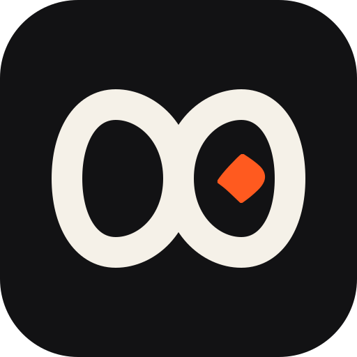

<p align="center"></p>

<h1 align="center">Dawem</h1>

<p align="center">Private notes, journal, tasks and habits, by <a href="https://github.com/zimamlabs">Zimam</a>. Formerly Lantern.</p>

Notes, a journal, tasks and habits in one private app. Your data is plain files in a folder you own, so it works offline, opens in any editor and moves between your phone and laptop by copying the folder.

Dawem (داوم, "keep at it") runs on **Android** and **Linux** (Debian and Ubuntu) from one codebase.

## What is in it

- **Today**: an affirmation and tip, streaks, today's habits and tasks, and the journal, in an order you choose.
- **Notes**: Markdown notes with tags, pinning and search; a reading view and an edit view.
- **Journal**: one entry a day with a mood, and a look back through the days.
- **Tasks**: lists and a checklist with due dates (today, tomorrow, next week) and priorities.
- **Habits**: daily or chosen weekdays; swipe to check or undo, hold to skip; week and month views, streaks that skip days you skip on purpose, and a page for each habit with its history.
- **Insights**: a day, week or month in numbers: what you wrote, did and kept up, with mood and habits by day.
- **Search** across notes, journal entries and tasks, from one place.
- **Themes**: Zimam (warm paper and near-black with an orange accent) and five more palettes, each in light and dark, or follow the system.
- **Export** the whole vault as a zip from Settings.

## Your data

Everything lives in one vault folder (`~/Dawem` on Linux; `Dawem` on the phone):

```
notes/<title>-<id>.md          Markdown with a small header (id, title, tags, dates)
journal/<year>/<date>.md       one file a day: mood in the header, text below
tasks/Tasks.md                 a Markdown checklist
habits/habits.json, log.csv    what you track, and the days you did it
.lantern/                      settings and the trash
```

Open the folder in Obsidian, a text editor or a spreadsheet; Dawem reads it back. To move to another device, copy the folder or sync it with any file-sync tool.

On Android the vault is private to the app by default. In the app you can allow *All files access* to keep it in a visible `/Dawem` folder instead.

## Install

Get the files for your system from the [latest release](../../releases/latest). Each file has a matching `.sha256` checksum.

| System | File |
|---|---|
| Android phone (64-bit, almost every phone since 2016) | `Dawem_<version>_Android_arm64-v8a.apk` |
| Android, older 32-bit | `Dawem_<version>_Android_armeabi-v7a.apk` |
| Android emulator, Chromebook | `Dawem_<version>_Android_x86_64.apk` |
| Debian, Ubuntu, Mint | `Dawem_<version>_Linux_amd64.deb` |

```
sha256sum -c Dawem_<version>_Linux_amd64.deb.sha256
sudo apt install ./Dawem_<version>_Linux_amd64.deb
```

### Verify the Android download

Every APK is signed with Dawem's own key. Android installs it without a store because the signature is valid, and shows its usual "unknown source" notice for anything that did not come from Google Play. To check a file is really ours, compare its signing certificate with this fingerprint:

```
SHA-256: 09:7A:B4:82:7A:35:AF:FB:5A:0D:D5:AB:01:26:EA:77:10:6B:29:4A:83:B4:E6:A8:B8:32:91:33:64:F0:EB:EA
```

```
apksigner verify --print-certs Dawem_<version>_Android_arm64-v8a.apk
sha256sum -c Dawem_<version>_Android_arm64-v8a.apk.sha256
```

## Build

You need JDK 17 or newer and, for Android, the Android SDK (platform 36).

```
./gradlew :shared:desktopTest            # the vault tests
./gradlew :composeApp:run                # run the desktop app
./gradlew :composeApp:assembleDebug      # Android debug APKs
./gradlew :composeApp:packageDeb         # Linux .deb
```

The code is split in two: `shared` holds the vault format and the logic (plain Kotlin, tested without a screen), and `composeApp` holds the screens for both platforms.

## Roadmap

Reminders with sticky notifications, widgets, sync between devices, recurring tasks and charts. Money tracking left Dawem and became its own app, Zimma.

## Licence

MIT. See [LICENSE](LICENSE).
